<!-- ================= HERO ================= -->

## 🧑‍💻 About

<table>
<tr>
<td width="60%" valign="top">

I'm **Ravish (Lexlonnn)**, a developer who builds **3D websites** and **custom software**, and works on **drone technologies** at Exodia Technologies.

- 🎓 **B.Tech CSE** at ASIET (2024 – 2028)
- 💼 **Developer Intern** at Exodia Technologies (part-time)
- 🎟️ Built event platforms used by **2k+** and **4k+** users
- 🏆 **2× hackathon winner**: IBM Kerala AI Hackathon, MBITS
- 🤖 Learning **AI/ML**

</td>
<td width="40%" align="center">

</td>
</tr>
</table>

## 📄 Resume at a Glance

| | |
|:--|:--|
| **💼 Experience** | Developer Intern @ **Exodia Technologies** · Part-time · Feb 2026 – Present |
| **🎓 Education** | B.Tech Computer Science & Engineering · ASIET · 2024 – 2028 |
| **🎟️ Event Platforms** | Ashwamedha (2k+ users) · Brahma 2026 (4k+ users) |
| **🏆 Achievements** | Winner, Kerala AI Hackathon (IBM) · 1st Place, MBITS Hackathon |
| **🌱 Learning** | AI / Machine Learning |

<!-- ================= EXPERIENCE ================= -->

### 🚁 Exodia Technologies
**Developer Intern** · Part-time · Feb 2026 – Present

Working across drone technologies. Project details are private.

<!-- ================= EVENT PLATFORMS ================= -->

<table>
<tr>
<td width="50%" valign="top">

### 🎟️ Ashwamedha
**Fest event registration platform** · Team project

I built the **complete website, frontend and backend**. Attendees register, get their ticket, and the whole event registration runs on it.

**👥 2k+ users**

- QR tickets and automated digital passes
- Admin tools for organizers

</td>
<td width="50%" valign="top">

### 🎭 Brahma 2026
**Cultural fest platform, Adi Shankara** · Team project

I built the **complete backend** powering the fest's platform.

**👥 4k+ users**

</td>
</tr>
</table>

<!-- ================= PROJECTS ================= -->

<table>
<tr>
<td width="33%" valign="top">

### 👁️ Blinkr
🥇 **1st Place · MBITS Hackathon**

Long screen time cuts blinking and strains eyes. Blinkr uses subtle on-screen cues and adaptive brightness to build healthier screen habits.

</td>
<td width="33%" valign="top">

### 🌊 Floodrix
🏆 **Winner · Kerala AI Hackathon by IBM**

Flood prediction and rerouting for Kerala's truck and lorry drivers. An `XGBoost` model predicts flood risk, and a full map module reroutes drivers around danger.

</td>
<td width="33%" valign="top">

### 🛡️ Heuristic
🔐 **Personal project**

Privacy-focused security agent that runs in the background on laptops. It flags suspicious programs using digital signature checks, thread monitoring and network leak detection, with a focus on camera and mic access.

</td>
</tr>
</table>

<!-- ================= ACHIEVEMENTS ================= -->

| Hackathon | Result | Project |
|:--|:--|:--|
| Kerala AI Hackathon by IBM | 🏆 Winner | Floodrix |
| MBITS Hackathon | 🥇 1st Place | Blinkr |

<!-- ================= TOOLS ================= -->

**Tools:** `Next.js` · `Node.js` · `Three.js` · `Flutter` · `Python`

**I build:** 3D websites · Custom software

## 📊 GitHub Analytics

## 🌱 Currently

<!-- ================= CONTACT ================= -->

