<!-- ================= HERO ================= -->

<!-- ================= ABOUT ================= -->

I'm **R B Ravish (Lexlonnn)**, a **Full Stack Developer** and **Backend Systems Engineer**. I build web platforms and scalable backends, and currently work on **drone technologies** at Exodia Technologies. Learning **AI/ML**.

<!-- ================= EXPERIENCE ================= -->

**🚁 Developer Intern · Exodia Technologies**  
Part-time · Feb 2026 – Present  
Working across drone technologies. Project details are private.

<!-- ================= TECH STACK ================= -->

**Full stack development · Backend systems**

<!-- ================= FEATURED WORK ================= -->

<table>
<tr>
<td width="50%" valign="top">

### 🎭 Brahma 2026
**Cultural fest platform · Adi Shankara**

Built the **complete backend** powering the fest's platform, as part of a team.

**👥 4k+ users**

</td>
<td width="50%" valign="top">

### 🎟️ Ashwamedha
**Fest event registration platform**

Built the **complete website, frontend and backend**, as part of a team. 

**👥 2k+ users**

</td>
</tr>
</table>

<!-- ================= PROJECTS ================= -->

<table>
<tr>
<td width="33%" valign="top">

### 🌊 Floodrix
🏆 **Winner · Kerala AI Hackathon by IBM**

**Problem:** Monsoon flooding strands trucks and lorries on Kerala's roads.

**Solution:** An `XGBoost` model trained on open-source flood data predicts flood risk ahead of time. A full map module then reroutes drivers around high-risk roads.

**Stack:** `Python` · `XGBoost`

</td>
<td width="33%" valign="top">

### 👁️ Blinkr
🥇 **1st Place · MBITS Hackathon**

**Problem:** Long screen time reduces blinking, which leads to dry, strained eyes.

**Solution:** A background assistant built fully in Python. Subtle on-screen cues are designed to trigger the subconscious urge to blink, while adaptive brightness reduces strain.

**Stack:** `Python`

</td>
<td width="33%" valign="top">

### 🛡️ Huristi
🥈 **2nd Place · Hackathon**

**Problem:** Apps can quietly access your camera, mic and network without you knowing.

**Solution:** A background security agent that monitors running programs. It flags suspicious ones using digital signature checks, thread monitoring and network leak detection, with a focus on camera and mic privacy.

**Stack:** `Python`

</td>
</tr>
</table>

<!-- ================= GITHUB STATS ================= -->

 

<!-- ================= CONTACT ================= -->

